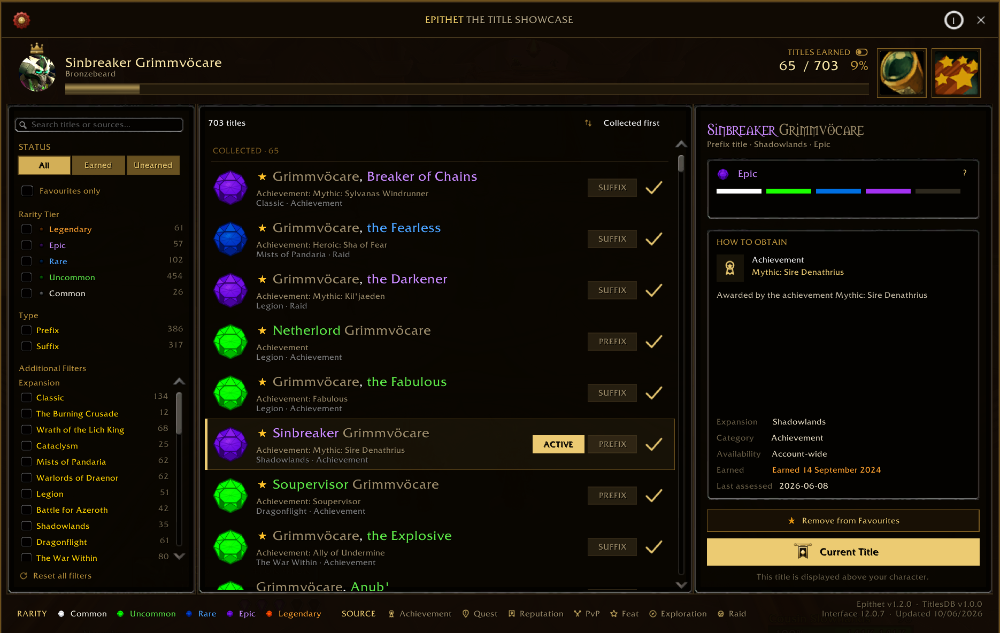
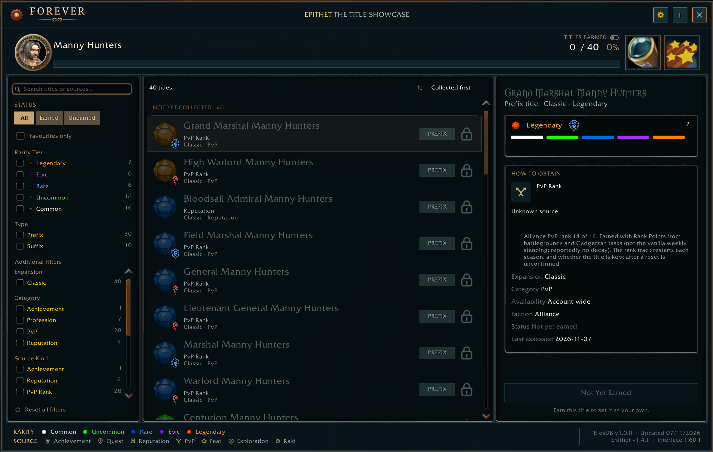

<div align="center">


# Epithet

**Every title you've earned, in one hall of names.**

[](../../releases)
[](#flavours)
[](#flavours)
[](#flavours)
[](#languages)
[](LICENSE)

[Screenshots](#screenshots) · [Features](#features) · [Usage](#usage-in-game) · [Contributing](#contributing) · [Release notes](docs/RELEASE_NOTES.md)

</div>

---

Epithet is a collections add-on for the one reward World of Warcraft never gave a proper home: your titles. *the Astral Walker. Hand of A'dal. Scarab Lord.* Each one is a story, a raid cleared, a grind survived, a moment that mattered. Epithet gathers them into a single calm, scholarly journal so you can browse, filter, and equip any title in two clicks, without digging through menus or fumbling slash commands (although we do have slash commands if that's your thing).

It looks and feels (hopefully) like a quiet hall of heraldry, built for prestige rather than flash.

Epithet runs on both **Retail** (and PTR) and **WoW Forever**, each with its own title data, achievements, release notes and colour theme.


<sub>Banner provided by Cpt. Jonah at CurseForge for Epithet placing in the top 10 Finalists of the 2026 WoW Midnight Add-on Competition.</sub>

## Screenshots

<table>
  <tr>
    <td align="center" width="50%">
      <a href="docs/screenshots/main-window-retail.png"></a>
      <br /><b>Retail</b> · the gold theme
    </td>
    <td align="center" width="50%">
      <a href="docs/screenshots/main-window-forever.png"></a>
      <br /><b>WoW Forever</b> · the Verdigris theme
    </td>
  </tr>
</table>

<sub>Click a screenshot to see it full size.</sub>

## Features

### Title Browser

- **Full title catalogue** - enumerates all titles via the client API, joined with a curated static database containing source info, expansion, and rarity.
- **Rarity tiers** - colour-coded Common → Legendary, displayed in standard WoW item-quality colours, with an in-app popup explaining how the percentages are estimated.
- **Collection tracking** - earned vs unearned at a glance, with a collected count (optionally scoped to obtainable-only titles).
- **Filters** - by expansion, status (earned/unearned), rarity, type, category, prefix/suffix, faction, favourites-only, hide-unobtainable, hide-time-sensitive, and free-text search.
- **Favourites** - star any earned title; favourites pin to the top of the Collected group in "Collected First" sort mode and show a star prefix in the list.
- **Set title** - "Set as My Title" button wired to a hardware event (required by the protected `SetCurrentTitle` API).
- **About modal** - addon and author info from a title-bar info button.

### Title Spotting (Social Layer)

- **Target nameplate overlay** - shows the title currently displayed by whoever you're targeting, anchored below the Blizzard target frame.
- **Two layouts** - "Slimline" (classic) and "Portrait Card", with an optional animated 3D portrait, configurable fade-out on target loss, and a draggable/lockable position.
- **Visibility rules** - optional auto-hide in combat or in a group, so the overlay stays out of the way when it isn't wanted.
- **Spotting Log** - a persistent, per-character log of titles you've spotted on other players, with list/grid views and scope toggle (spotted vs. remaining), plus import/export for sharing logs.
- **Epithet Achievements** - a dedicated achievement system built on top of spotting and collection data: progression tiers, coverage goals, crossover and secret achievements, earned-record persistence, and optional chat notifications. Opened from its own header button, separate from the Spotting Log.

### WoW Forever Support

- **Its own title data** - all 40 Forever titles, including both factions' PvP rank ladders, with faction variants told apart by your faction.
- **Verdigris theme** - a Forever-only colour theme taken from the Forever logo: deep-sea panels, bronze frames, a bronze compass ring around your portrait, and a "FOREVER" badge in the title bar.
- **Forever achievements** - 64 Epithet Achievements, including ones made for Forever (rank ladders, rival centaur clans, families, race and class pairings, campfires, launch week).
- **First and last names** - the header shows your full name, and a surname is never mistaken for a title.

### Languages

| English | Deutsch | Français | Русский | 简体中文 |
| :-----: | :-----: | :------: | :-----: | :------: |
| `enGB`  | `deDE`  |  `frFR`  | `ruRU`  |  `zhCN`  |

UI, settings, achievements and What's New are translated in every language, and Retail also loads localised title database overlays. See [docs/LOCALIZATION.md](docs/LOCALIZATION.md).

### Quality of Life

- **What's New popup** - a themed, version-mapped changelog dialog shown after an update that has notes, with separate notes for Retail and Forever; reopen anytime with `/epithet whatsnew`, or turn the automatic popup off in settings.
- **Minimap button** - via LibDataBroker/LibDBIcon, with a tooltip showing your current collected count; toggle with `/epithet minimap`.
- **Slash commands** - `/epithet` (or `/titles`) toggles the browser window; see [Usage In-Game](#usage-in-game) for the full list.

## Usage In-Game

1. Install the addon to `Interface/AddOns/Epithet/`.
2. Open the title browser with `/epithet` or `/titles`.

| Command             | What it does                                                            |
| ------------------- | ----------------------------------------------------------------------- |
| `/epithet`          | Toggles the title browser (`/titles` works too)                         |
| `/epithet scan`     | Forces a title rescan                                                   |
| `/epithet minimap`  | Toggles the minimap launcher button                                     |
| `/epithet whatsnew` | Reopens the What's New dialog for the current version                   |
| `/epithet debug`    | Dumps raw title API output for the first known titles (troubleshooting) |

> [!TIP]
> Title Spotting, the Spotting Log, and Epithet Achievements are configured from the addon's Options panel and opened via the header buttons in the main window.

## Rarity Heuristic

Since no authoritative rarity feed exists, rarity is derived from acquisition category:

| Tier | Label                                                                                   | Criteria                                                                            |
| :--: | --------------------------------------------------------------------------------------- | ----------------------------------------------------------------------------------- |
|  5   |            | Seasonal PvP Glad/R1/Hero, Grand Marshal/High Warlord, Scarab Lord                  |
|  4   |                      | Removed/unobtainable, Challenge Mode Gold, Hall of Fame, Cutting Edge, "the Insane" |
|  3   |                      | Multi-patch meta-achievements (Loremaster, Glory metas), M+ score titles            |
|  2   |              | Single achievements, holiday metas, campaign completion, exploration                |
|  1   |                  | Baseline rep grinds, low PvP ranks, trivial quest rewards                           |

Rarity is stored per title in the generated title database. If a title's tier looks wrong, open a [Title Correction](../../issues/new?labels=correction&template=title-correction.md) issue.

## Flavours

One addon, one codebase, one version number. Each game loads the shared code plus only its own flavour files, and the build makes a lean zip per game.

| Flavour     | Game type in the TOC | Client                                | Theme     |
| ----------- | -------------------- | ------------------------------------- | --------- |
| **retail**  | `standard`           | Retail live (120105) and PTR (120107) | Gold      |
| **forever** | `camelot`            | WoW Forever (16001)                   | Verdigris |

See [docs/FLAVOURS.md](docs/FLAVOURS.md) for where flavour differences live and the rules that keep shared code flavour-free.

## API Research

Warcraft Wiki - confirmed on 12.0.1 mainline; also used on WoW Forever 1.60.1.

| Function                   | Signature                                   | Notes                                                               |
| -------------------------- | ------------------------------------------- | ------------------------------------------------------------------- |
| `GetNumTitles()`           | `numTitles = GetNumTitles()`                | Returns the **highest** title ID (sparse - gaps exist)              |
| `GetTitleName(titleId)`    | `name, playerTitle = GetTitleName(titleId)` | Trailing space in `name` → prefix; otherwise suffix                 |
| `IsTitleKnown(titleId)`    | `isKnown = IsTitleKnown(titleId)`           | Boolean - the character has earned it                               |
| `GetCurrentTitle()`        | `currentTitle = GetCurrentTitle()`          | Returns active title ID (0 = none)                                  |
| `SetCurrentTitle(titleId)` | `SetCurrentTitle(titleId)`                  | **Protected** - must originate from a hardware event (button click) |

> [!NOTE]
> The API exposes **only** the title list and known/unknown state. It does **not** provide rarity or source - hence the static data table.

## Project Structure

<details>
<summary>Show the full file tree</summary>

```txt
Epithet/
├── Epithet.toc              # Addon manifest
├── Core/
│   ├── Epithet.lua          # Addon bootstrap, slash commands, minimap button, event wiring
│   ├── Theme.lua            # Every colour as a named token, skin helpers, per-flavour Theme.Apply
│   ├── Flavor.lua           # Flavour settings (ns.Flavor) with the Retail defaults
│   ├── TitleData.lua        # Live title scan and static data bridge
│   ├── Filters.lua          # Filtering, sorting, and display list logic
│   ├── Settings.lua         # Blizzard settings panel
│   ├── SocialLayer.lua      # Target-frame title spotting overlay
│   ├── WhatsNew.lua         # What's New popup runtime
│   ├── SocialLayouts.lua    # Social layout registry
│   └── SocialLayouts/
│       ├── classic.lua      # "Slimline" layout implementation
│       └── portrait.lua     # "Portrait Card" layout implementation
├── UI/
│   ├── MainFrame.xml        # Main window layout
│   ├── MainFrame.lua        # Main window controller
│   ├── TitleList.lua        # Virtualized title list
│   ├── Sidebar.lua          # Filter sidebar
│   └── Detail.lua           # Title detail panel
├── Spotting/
│   ├── TitleIndex.lua       # Runtime title fragment index
│   ├── Capture.lua          # Spot capture and debounce logic
│   ├── Achievements.lua     # Epithet Achievements system
│   ├── Log.lua              # Spot log persistence and import/export
│   └── LogbookUI.lua        # Spotting log and achievements UI
├── WhatsNew/
│   ├── Content.lua          # What's New content registry
│   ├── Retail/              # Retail's release notes, one file per version ([AllowLoadGameType standard])
│   └── Forever/             # WoW Forever's release notes ([AllowLoadGameType camelot])
├── Flavors/                 # What differs per game flavour (see docs/FLAVOURS.md)
│   ├── Retail/
│   │   └── Achievements.lua # Retail's achievement list ([AllowLoadGameType standard])
│   └── Forever/             # [AllowLoadGameType camelot]
│       ├── Flavor.lua       # Flavour settings (ns.Flavor)
│       ├── Theme.lua        # The "Verdigris" theme overrides
│       └── Achievements.lua # Forever's achievement list
├── data/                    # One folder per flavour, nothing at the root (collector-generated, gitignored)
│   ├── retail/              # Retail live and PTR ([AllowLoadGameType standard])
│   │   ├── TitlesDB.enGB.lua    # Bundled static title database (enGB base / canonical)
│   │   ├── TitlesDB.<code>.lua  # Sparse localised prose overlays (deDE, frFR, ruRU, zhCN)
│   │   └── schema.json          # Data schema
│   └── forever/             # WoW Forever ([AllowLoadGameType camelot])
│       ├── TitlesDB.enGB.lua    # Separate title set with its own title IDs
│       └── schema.json
├── Locales/
│   ├── LocaleManager.lua    # Locale registry, ns.L proxy, resolution API
│   ├── enGB.lua             # Default locale strings
│   └── deDE / frFR / ruRU / zhCN.lua  # Translations
├── libs/                    # Embedded Ace3 + LibDataBroker/LibDBIcon (see below)
├── icons/
├── docs/                    # Release notes, technical guides and README screenshots
├── scripts/                 # Build, fetch-libs, link, probe, release and validate scripts
├── tools/
│   ├── tests/               # Tests for both flavours, in a Lua VM (cd tools/tests; npm install; npm test)
│   └── probe/               # Dev-only diagnostics addon for client differences (never shipped)
├── LICENSE
├── NOTICE
└── README.md
```

</details>

## Dependencies

- **Ace3** (AceAddon-3.0, AceDB-3.0, CallbackHandler-1.0) - BSD licensed.
- **LibDataBroker-1.1** and **LibDBIcon-1.0** - power the minimap launcher button.
- All dependencies are OSI-approved.

<details>
<summary>Installing libs</summary>

Download from [CurseForge](https://www.curseforge.com/wow/addons/ace3) or run `scripts/fetch/fetch-libs.ps1`. Place in `libs/`:

```txt
libs/
├── LibStub/
├── CallbackHandler-1.0/
├── AceAddon-3.0/
├── AceDB-3.0/
├── LibDataBroker-1.1/
└── LibDBIcon-1.0/
```

</details>

## Contributing

### By Creating Issues

Found a missing title, incorrect data, or an obtainability change? Open an issue using one of the templates below:

| Template                                                                                                     | When to use                                                          |
| ------------------------------------------------------------------------------------------------------------ | -------------------------------------------------------------------- |
| **[Bug Report](../../issues/new?labels=bug&template=bug-report.yml)**                                     | A bug is found in the addon                                          |
| **[New Title](../../issues/new?labels=new-title&template=new-title.md)**                                  | A title exists in-game but is missing from the database              |
| **[Title Correction](../../issues/new?labels=correction&template=title-correction.md)**                   | Any field on an existing title is wrong (rarity, source, type, etc.) |
| **[Obtainability Change](../../issues/new?labels=obtainability-change&template=obtainability-change.md)** | A title was removed, re-added, or made seasonal in a patch           |
| **[Bulk Update](../../issues/new?labels=bulk-update&template=bulk-update.md)**                            | Multiple titles added/changed in a single patch or event             |
| **[Feature Request](../../issues/new?labels=enhancement&template=feature_request.yml)**                   | An idea for a new feature or improvement                             |

Please include patch notes, in-game screenshots, or official sources as evidence where possible.

### Further Reading

- [docs/RELEASE_NOTES.md](docs/RELEASE_NOTES.md) - the full version history
- [docs/WHATS_NEW_FEATURE.md](docs/WHATS_NEW_FEATURE.md) - how the in-game What's New system works
- [docs/FLAVOURS.md](docs/FLAVOURS.md) - how Retail and WoW Forever share one codebase
- [docs/LOCALIZATION.md](docs/LOCALIZATION.md) - adding and maintaining translations
- [docs/CURSEFORGE_WEEKLY_RECOMMENDER.md](docs/CURSEFORGE_WEEKLY_RECOMMENDER.md) - weekly feature recommendation automation

### Pull Requests

It's great to see people enjoying Epithet as an add-on to the extent that they get involved in improving the tool, below are some of Epithet's contributors.

#### Named Locale Contributors

| Contributor                                                                                                                          | Contribution                                                                                                                  |
| ------------------------------------------------------------------------------------------------------------------------------------ | ----------------------------------------------------------------------------------------------------------------------------- |
|  [Hubbotu - ZamestoTV](https://github.com/Hubbotu)          | ruRU locale/lang files. Big thanks for creating a [YouTube short on Epithet as well!](https://youtube.com/shorts/GHA6q1ljAx0?si=U8TiVp7YolphpXuE) |
|  [AlexTend](https://github.com/alextend)                   | zhCN locale/lang files                                                                                                     |

## License

Apache-2.0 license - see [LICENSE](LICENSE).

> [!IMPORTANT]
> If your addon or tool reads Epithet's data or capabilities at runtime (e.g. the `EpithetData` global) to enrich its own UI, please display a visible credit in that UI - see [NOTICE](NOTICE) for specifics. Thanks for playing nice.

> [!CAUTION]
> The hand-written `obtainability_reason` prose in the title database is authored content and is **not** licensed for reproduction elsewhere - see the "Reserved content" section of [NOTICE](NOTICE).
